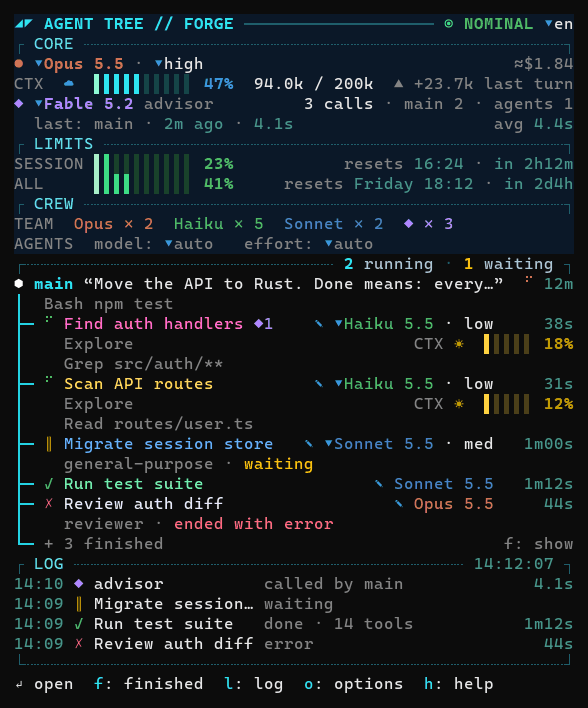
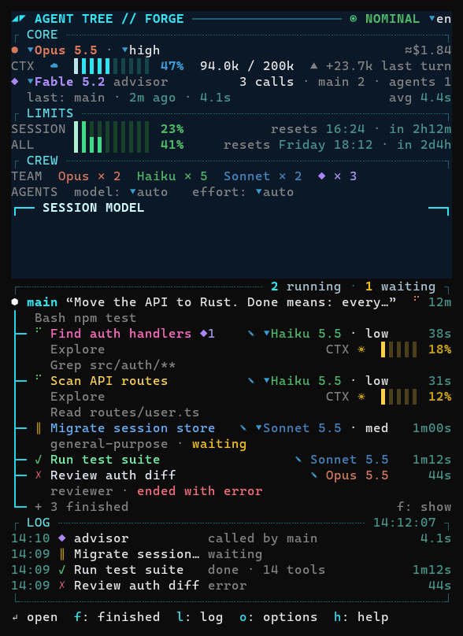
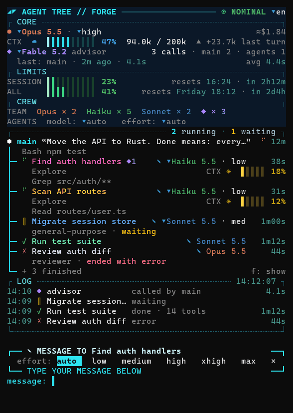
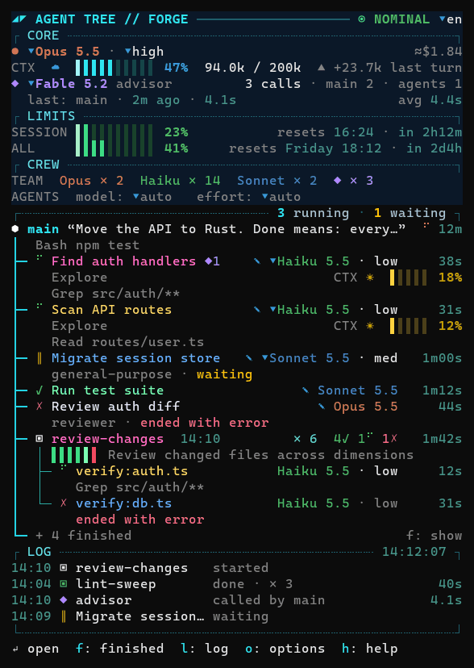
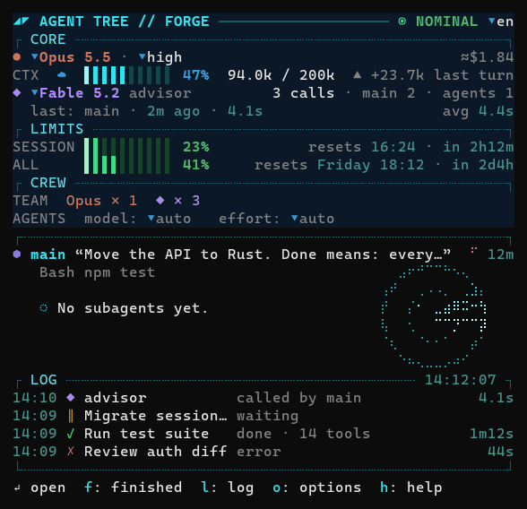
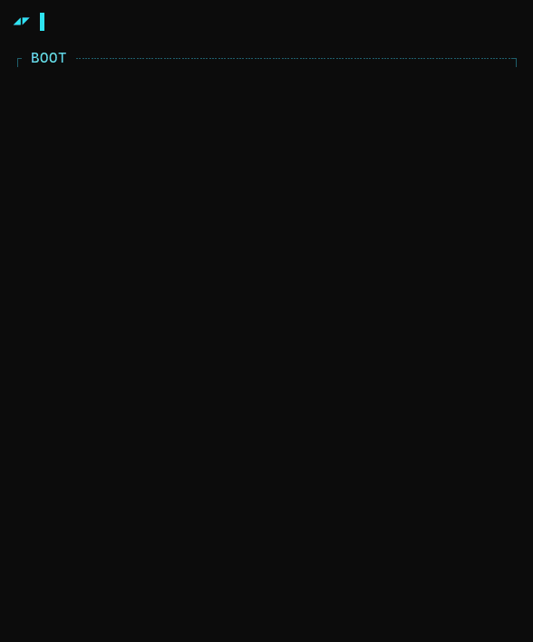

# Agent Tree // Forge

**Agent Tree // Forge** is a mod (a plugin) for [Claude Code](https://claude.com/claude-code) that adds a live side pane to its terminal. The pane shows everything the current session runs as one tree: the main conversation, every subagent and workflow run, and the advisor's calls. Each comes with its model, effort, status, current tool and context use, under a header with the session's context, usage limits and cost.

**What it is good for**
- **Seeing what Claude does while it works:** which agents run, on which model, what each is doing now, and which finished, wait or failed.
- **Keeping an eye on the budget:** the context window, the 5-hour and 7-day usage limits with their reset times, the estimated cost, and how often the advisor was called.
- **Steering from the pane:** switch the session's model, effort or advisor, choose what new subagents get, move a running agent to another model, or send an agent a message.

**Where and with what**
- Claude Code 2.1.328 or newer, in its terminal interface, on Windows, macOS or Linux. It runs on Claude Code's mods API, which is early access and may change between releases.
- The pane docks beside the chat in fullscreen mode when the terminal is wide enough (about 110 columns); otherwise `/tree` opens it.
- Its interface speaks 23 languages. It comes in a sci-fi look, the Forge HUD, or a classic one, with optional sounds and notifications.

It watches, and changes nothing unless you pick something in the pane. It makes no model calls, and its only network call is a daily check for its own update, which you can switch off (see [Updates](#updates) and [PRIVACY.md](PRIVACY.md)).

## See it in action

<p align="center"></p>

**While Claude works.** The header sums up the session: the model and effort, the context's fill, the usage limits and the advisor. Under it every agent is a row with its model, its current tool and its context use, and a comet runs down the tree's lines. The log at the foot types in what just happened.

<table>
  <tr>
    <td width="50%" valign="top"><br><b>Choice panels.</b> A <code>▾</code> opens a panel under the header: the session's model, effort or advisor, or what new subagents get. Picking one runs the same command you would type (<code>/model</code>, <code>/effort</code>, <code>/advisor</code>), and the header shows it pending until it takes effect.</td>
    <td width="50%" valign="top"><br><b>A message to an agent.</b> The <code>✎</code> on an agent's row opens a message panel at the pane's foot. A running agent reads the message at its next step, and a finished one is resumed with it, at the effort chosen above the field.</td>
  </tr>
  <tr>
    <td width="50%" valign="top"><br><b>Workflow runs.</b> A workflow run is one row: its name, its agents counted by state, its time, and a squad bar of their states. Its agents at work hang under it, and a press on the row shows all of them.</td>
    <td width="50%" valign="top"><br><b>An empty tree.</b> Until the first subagent starts, a radar sweeps beside “No subagents yet.” The header and the log work as ever.</td>
  </tr>
  <tr>
    <td colspan="2" align="center"><br><b>The boot.</b> The first time the pane opens, the Forge HUD boots: the title types in, the systems report, then the pane draws itself in. The Motion option, or Claude Code's reduced-motion setting, stills this and every other effect.</td>
  </tr>
</table>

## How it behaves

The mod watches. It changes something only when you pick it in the pane:
- the session's model, effort or advisor (it runs `/model`, `/effort` or `/advisor` for you, as if typed);
- the model and effort new subagents get, for the session;
- a running subagent's model, from its next request;
- a message you send an agent from the pane, and the effort it goes with;
- the mod's own options, on its options page (as `/config` sets them).

Every other hook passes its event on unchanged, and so does a fault in the mod.

## Look and sound

It comes in a sci-fi look, the **Forge HUD**: a title bar with a status lamp, labelled rails between the groups, LED bars, the main session as a violet core at the tree's root, panels in corner brackets, a neon palette and a navy plate on a dark theme. And it moves: a comet runs down every line of the tree, the core beats while Claude works, new log rows type themselves in, a new agent's name materialises, a finished one flashes, a failed one glitches, panels unfold, a scan line passes, a radar sweeps an empty tree, and the pane boots up the first time it opens. The classic look is one option away, and the Motion option stills all of it. It can also play **sci-fi sounds** for what happens: an advisor call, an agent starting, finishing, failing or waiting, the end of a turn, a red alert, the pane powering up. They are on by default, but for the advisor's call and a new agent's start; every one has its own switch.

It also sends **notifications** through Claude Code's own notification channel, so they reach you away from the terminal too: when an agent waits for you, an agent or a workflow run fails, a workflow run finishes, the main answer is done, or a red alert rises. A kind comes at most every 30 seconds; what comes meanwhile is merged into the next one. In the Claude desktop app a notification shows only if you have not come back to the session within 20 seconds; a terminal shows it at once, as its notification channel allows. Where Claude Code has no channel in the terminal (Windows Terminal, for one), on Windows the mod shows it as a Windows notification itself (see [Notifications on Windows](#notifications-on-windows)). They are on by default, and every one has its own switch; the notifications page shows what came of the last one.

## Notifications on Windows

Claude Code sends a notification through the channel its settings name (`/config` → Notifications). Left on `auto`, that channel finds nothing in Windows Terminal, so on its own no notification would show there. In that case the mod shows its notifications itself:

- **As a Windows notification**, through Windows PowerShell, which comes with Windows 10 and 11 (no module to install). Windows lists it under **Windows PowerShell**, titled `Agent Tree // Forge`.
- **Silent**, as the mod's own sounds speak for it (with Sound on).
- **One per kind** in the notification center: a newer one replaces the older, so they do not pile up.
- **At once**: a terminal has no "only when you are away", so with the default switches the end of every main answer brings one too. Any event can be switched off on the notifications page (`o`, then `Notification events`).
- **Only where Claude Code has no channel**: never when you turned notifications off in Claude Code, nor when you chose a channel there, such as the terminal bell.
- **Windows decides whether the banner shows**: in Do not disturb, or with notifications turned off for Windows PowerShell, it only lands in the notification center.

The notifications page shows what came of the last one under its heading (`last: ✓ sent as a Windows notification`, or why nothing was shown), and `►` there sends a test of any event now.

## Install

From a terminal:

```bash
claude plugin install forge-agent-tree --marketplace JZO001/forge-agent-tree
```

Inside a session:

```text
/plugin install forge-agent-tree --marketplace JZO001/forge-agent-tree
```

## Use

- In fullscreen mode, the pane opens beside the chat when a session starts, if the terminal is wide enough (about 110 columns or more).
- Otherwise, or after closing it, open it with `/tree`. Close it with `/tree close`.
- Press `ctrl+x tab` to focus the pane. Then:
  - `↑` / `↓` move between the pane's buttons (an agent's row has two or three: the row, `✎`, and a running agent's model).
  - `Enter` or a click opens an agent's transcript in the main view.
  - The `main` row goes back to the conversation.
  - `f` shows or hides finished agents.
  - `l` shows or hides the log. Both `f` and `l` are remembered for the next sessions.
  - `o` opens the options page: every option of the mod, switched or stepped with a press (`on`/`off`, `− 5 +`), and the language. The choices go into Claude Code's settings, as `/config` saves them, for every session. Its `Sound events ▸` row opens the sounds page: each sound with `►` to hear it now and its own switch. Its `Notification events ▸` row opens the notifications page: each notification with `►` to send a test now (a toast says whether it went out, and through which channel) and its own switch.
  - `h` opens the legend; it also says how to close the pane (`/tree close`) and open it again (`/tree`).
- `▾Opus 5.5 · ▾xhigh` in the second row: press the model or the effort to pick another in a panel under the header. The pane runs `/model` or `/effort` for you, so Claude Code also saves the choice as the default for new sessions, as it does when you type them. Until it has taken effect the row shows it pending (`→ Sonnet`).
- `◆ ▾Fable 5.2 advisor`: press it to choose the advisor (Fable, Opus, Sonnet) or turn it off; the pane runs `/advisor` for you.
- `agents  model: ▾auto   effort: ▾auto`: what new subagents get, this session only. A model chosen here applies even where Claude asks for another (not to forks, resumed runs or workflow agents). An effort chosen here goes with every request of the subagents that start afterwards; agents already at work keep theirs. A `/resume` brings the session's choice back.
- `▾Haiku 5.5 · low` on a running subagent's row: press the model to switch that agent to another from its next request on (`auto` gives it back its own). A new model reads the agent's context again at its own price. The rest of the row still opens the agent's transcript. The effort of a running agent cannot be switched: Claude Code keeps the level its run started with.
- `✎` on an agent's row: write that agent a message. A framed panel opens at the foot of the pane, with the effort to send it with (`auto` keeps the agent's own), and under it a field of three lines that scrolls (`↑` / `↓` move in it); `Enter` sends, `Shift+Enter` starts a new line, `×` closes. A running agent reads it at its next request; a finished one is resumed with it. The log notes each message sent; one that was not delivered keeps the panel open and says why. What you typed is kept while the panel is closed.
- `▣ review-changes  × 6  4✓ 1⠹ 1✗` is a workflow run: one row for the whole run, with its name, when it started (where there is room), how many agents it started and where they stand, and its time. Under it are the agents at work, waiting or failed; the finished ones are only counted. Press the row to show all of its agents, and again to fold them (`f` shows every run's). The workflow script's description is on the line below. The log notes when a run starts and how it ends, not each of its agents. A run's agents take no message and no model switch: in a test, a message sent to one did not reach the workflow but started a second run of that agent afterwards.
- `+ n more` at the foot of the tree, where the pane cannot hold every agent: press it to page through the whole tree, a row an agent, the header and the keys staying in place. `▲` and `▼` turn the page (each page keeps the last row of the one before), `×` goes back. Once everything fits again (a taller pane, agents finishing), the pane goes back by itself.
- `▾en` at the end of the top row is the pane's language. Press it (a click, or `ctrl+x tab`, the arrows and `Enter`) and choose one of 23 in the panel that opens under the header: English, Magyar, Čeština, Dansk, Deutsch, Español, Français, Italiano, Nederlands, Norsk, Polski, Português, Română, Slovenčina, Slovenščina, Srpski, Suomi, Svenska, Türkçe, Ελληνικά, 日本語, 한국어, 中文. The choice is kept for every session. Until you choose, the pane follows Claude Code's `language` setting, then the system's display language, else English.

| Sign | Meaning |
|---|---|
| `⠹` | running (the spinner is drawn in the model's color) |
| `✓` | done (green) |
| `✗` | failed |
| `■` | stopped (yellow) |
| `◌` | starting (in the model's color) |
| `‖` | waiting |
| `○` | idle (in the model's color) |
| `◆` | advisor call (a server-side tool; Claude decides when to call it). Right under the context row, the advisor's block shows its model, how many calls the main session and the agents made, the last call (who, how long ago, how long) and the calls' average length |
| `◆2` | beside an agent: it asked the advisor twice |
| `ctx` | share of the context window as weather, the token-weather scale: ☀ <25% yellow, ☁ <50% cyan, ☂ <75% blue, ☇ <90% magenta, ↯ 90%+ red |
| `643.6k / 1M` | the context row: tokens in use over the window, as the token-weather band writes them |
| `▲ +23.7k` / `▼` | how the context grew or shrank over the last main turn (a compaction shrinks it) |
| `~` | the context share is a local estimate: right after a start, a `/resume`, a `/clear` or a compaction, until the first reply measures it |
| `≈$` | client-side cost estimate, not the bill |
| `session` / `all` | the plan's usage, a row a window (the session's 5 hours; the week's, which counts every model's use): a bar and the share used (green, yellow from 60%, red from 90%; both are options), then when it resets, the local time (another day by its name: `Friday 18:12`) and how long until (`resets 16:24 · in 2h12m`). Narrow panes name them `5h` and `7d`. The rows appear once a response has reported the limits, and only on a subscription; from a session's start the last known ones show, marked `~` (windows already reset left out), until a response confirms them. A /resume or /clear keeps them: they are the account's, not the session's |
| `▾en` | the pane's language; press it to choose one of 23 |
| `▾Opus 5.5` / `▾xhigh` | the session's model and effort; press to change them (runs `/model` / `/effort`) |
| `→ Sonnet` | a model or effort the pane asked for, until it has taken effect |
| `◆ ▾Fable 5.2` | the advisor; press to change it or turn it off (runs `/advisor`) |
| `agents ▾auto` | what new subagents get, this session: their model and effort |
| `▾Haiku 5.5` | on a running agent's row: switch its model from its next request on |
| `▾→Sonnet` | a switch for a running agent, until a request has gone with it |
| `✎` | beside an agent's model: send it a message (a finished one resumes) |
| `▣` | a workflow run, its agents under it, in the tree's line color (red when it failed); press to show all of its agents |
| `× 6  4✓ 1⠹ 1✗` | a workflow run's agents: how many it started, then how many are done (green), working (the model's color), failed (red); waiting `‖` and stopped `■` in yellow |
| `▲  ▼  9–16 / 34  ×` | the whole tree a page at a time, after pressing `+ n more`: turn the page, which rows show of how many, back |
| `· high` | effort, beside the session's and each agent's model: low, med, high, xhigh, max (narrow pane: lo, md, hi, xh, mx) |

## Options

These are set on the pane's options page (`o`) or from `/config`; both save them the same way. They are **global**: Claude Code keeps them in your user settings (`~/.claude/settings.json`, under `pluginConfigs`), for every session and every project. A copy run with `--plugin-dir` keeps its own (`forge-agent-tree@inline`), apart from an installed one.

| Option | Default | |
|---|---|---|
| Open on start | on | Open the pane when an interactive session starts |
| Forge HUD | on | The sci-fi look; off: the classic look. On a light or ANSI theme it keeps Claude Code's named colors and draws no plate |
| Motion | on | The spinner while Claude works; a light running along the bars of three cells or more, and a pulse down every line of the tree, idle too. Claude Code's reduced-motion setting turns it off too |
| Width | 56 | Columns the docked pane asks for; a width dragged by hand wins |
| Log rows | 5 | How many log rows the pane shows (0 to 20; the narrow view at most one); 0 hides the log |
| Limits: yellow from | 60 | The share (%) from which the session or all-models bar turns yellow, and the HUD's lamp shows CAUTION |
| Limits: red from | 90 | The share (%) from which it turns red, and the lamp shows CRITICAL; above the yellow one |
| Sound | on | Every sound of the pane at once; each event has its own switch on the sounds page: agent done, agent failed, agent waiting, turn complete, red alert and power-up are on, advisor call and agent deployed are off. macOS plays them itself, Windows through PowerShell, Linux through `paplay` or `aplay` |
| Notifications | on | Every notification at once, through Claude Code's notification channel (`/config`); each event has its own switch on the notifications page, all on: agent waiting, failure, workflow done, turn complete, red alert. The text names the agent, the workflow run or the start of your prompt. On Windows, where Claude Code has no channel in the terminal, the mod shows it as a Windows notification through PowerShell (see [Notifications on Windows](#notifications-on-windows)) |
| Line above the prompt | on | While the pane is closed, a line above the prompt sums up the agents, drawn as token-weather draws its own: `⠹ Opus 5.5  2 running  1 waiting · 4 done  ●●‖✓✗  ◆3 · ≈$1.84` |
| Auto-update | on | Once a day, a copy installed from the marketplace checks GitHub for a newer version and installs it (see [Updates](#updates)) |

### Global or this session only

What the pane sets, and how long it lasts:

| Kept | What | Where |
|---|---|---|
| **Global**, every session | the options above | Claude Code's user settings (`pluginConfigs`) |
| | the pane's language (`▾en`) | the mod's own store |
| | the session's model (`▾Opus 5.5`), effort (`▾xhigh`) and advisor (`◆ ▾Fable`) | Claude Code's settings: the pane runs `/model`, `/effort` and `/advisor`, which save them as the defaults for new sessions |
| | whether finished agents (`f`) and the log (`l`) show | the mod's own store |
| | when the last update check ran (once a day, see [Updates](#updates)) | the mod's own store |
| **This session only** | the model and effort new subagents get (`agents  model: ▾auto   effort: ▾auto`) | the mod's own store, by session: a `/resume` brings them back, a new session starts on `auto` |
| | a running subagent switched to another model | that agent, while it runs |
| | the effort sent with a message to a subagent | that agent's next requests |
| | the workflow runs opened or folded, the view shown (tree, help, options) | until the session ends |

## Updates

Claude Code updates plugins from a marketplace only where that marketplace has auto-update on, and for marketplaces other than the official ones it is off. So the mod checks for itself:

- **When:** once a day, when an interactive session starts; it never holds the start up.
- **How:**
  1. `claude plugin list --json` tells it the installed version, and whether it came from a marketplace. A copy run from a folder (`--plugin-dir`) is never updated.
  2. One request reads the version in the repository's `plugin.json` on GitHub.
  3. Only when that one is higher does it run `claude plugin update forge-agent-tree@<marketplace>`.
- **Afterwards:** a notice says the new version is installed; `/reload-plugins` or a restart loads it. If the update fails, the notice gives the command to run by hand, and that version is not tried again.
- **Off:** the Auto-update option (the options page, or `/config`), or any of these set: `DO_NOT_TRACK`, `DISABLE_AUTOUPDATER`, `DISABLE_UPDATES`, `CLAUDE_CODE_DISABLE_NONESSENTIAL_TRAFFIC`.
- **Privacy:** what the check sends and to whom is in [PRIVACY.md](PRIVACY.md).

Claude Code's own auto-update can be switched on for this marketplace too: `/plugin` → Marketplaces → `forge-agent-tree` → enable auto-update.

## Develop

```bash
claude --plugin-dir .       # load the mod from this folder; saving a file reloads it
claude plugin validate .    # read the manifest and the hooks module as the engine will
claude plugin test .        # run tests/*.test.ts(x) against the engine
```

Files:
- `hooks/register.tsx`: the hooks.
- `hooks/model.ts`: state changes as pure functions.
- `hooks/layout.ts`: the pane as rows sized to its columns and rows.
- `hooks/format.ts`: names, numbers and widths; times in the pane's language.
- `hooks/words.ts` and `hooks/langs-*.ts`: the pane's words in each of its 23 languages.
- `hooks/update.ts`: the daily update check, as pure decisions.
- `types/index.d.ts`: the `$.state` contract.

## License

Apache-2.0
